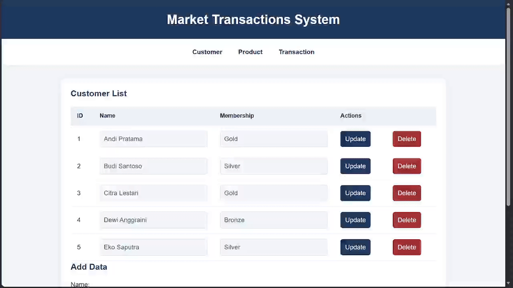
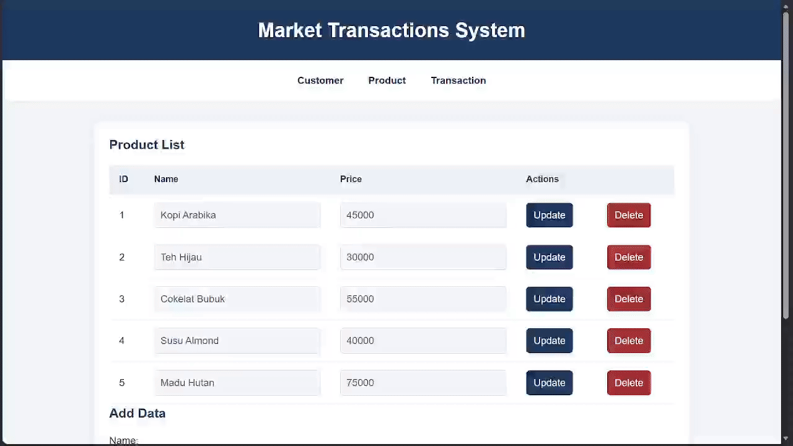
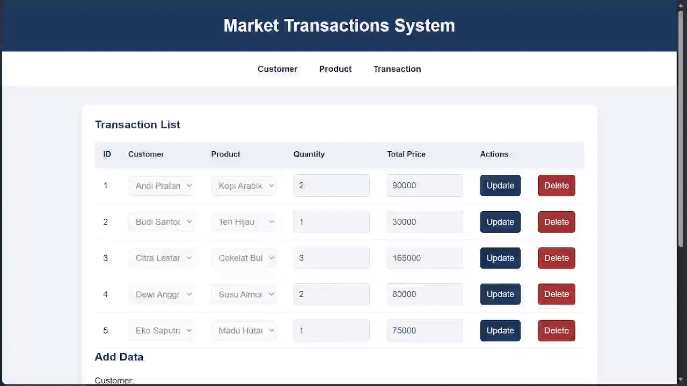

# TP7DPBO2526C1

## Janji
Saya Afif Fadilah Rahman dengan NIM 2508287 mengerjakan TP 6 dalam mata kuliah Desain Pemrograman Berbasis Objek untuk keberkahan-Nya maka saya tidak melakukan kecurangan seperti yang telah dispesifikasikan. Aamiin

## Desain Program
Program mengimplementasi desain 3-layered web application yang memisahkan tampilan web, application logic, serta database. Database disambungkan menggunakan PDO ke backend program melalui class Database pada config/db.php.\
\
Class Customer, Product, dan Transaction digunakan untuk mengambil data dari database yang terhubung melalui relasi Aggregasi ketiga class tersebut dengan class Database.\
\
Tampilan web dipisah menjadi beberapa bagian sesuai class yang ada dan disimpan di directory view. Application logic yang mengeksekusi PHP request dipisah ke directory backend. Javascript dan Css dipisah ke file berbeda dan dihubungkan ke index.php.

## Penjelasan Alur
Program memiliki variabel page dengan default 'customer' yang digunakan untuk menentukan tampilan tabel class yang sedang ditunjukkan. Kemudian navigasi yang telah dibuat digunakan untuk mengubah variabel page melalui method GET. Tabel akan ditampilkan melalui method getAll() pada class yang sesuai dengan page saat ini.\
\
Pada setiap tampilan class, terdapat form untuk menambahkan object baru pada class tersebut. Pada setiap object class terdapat action berupa update, delete, serta input form untuk mengedit data-data object secara langsung saat menekan tombol update.\
\
Pada setiap form dengan method POST, PHP request mengirim data seluruh attribut dari seluruh class ditambah dengan page dan action sebagai penanda class apa dan CRUD apa yang sedang dilakukan. Kemudian application logic akan memproses request tersebut sesuai kombinasi page dan action. Pada page transactions, nama customer dan nama product diinput menggunakan select option yang mengambil data dari masing-masing class Customer dan Product.\
\
Javascript digunakan untuk fitur update yang mana tombol memiliki dataset berupa editing yaitu dataset yang mengecek apakah object dalam row ini sedang di update. Jika object sedang diedit, saat tombol ditekan script akan meminta submit request dari form object tersebut, sedangkan jika tidak sedang diedit, script akan mengubah attribut input form menjadi editable.

## Dokumentasi

### Customer

### Product

### Transaction
